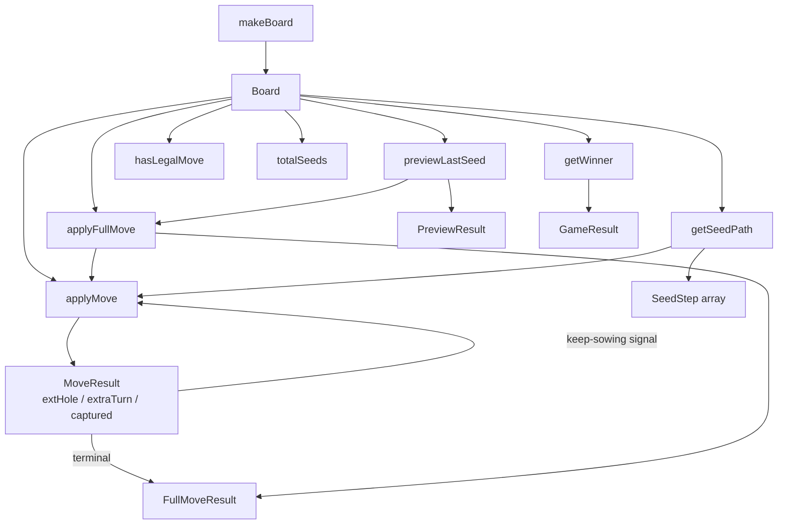

# Design Document

## Overview

This document covers the technical design for the pure TypeScript congkak game-logic module at `frontend/src/logic/congkak.ts`. A first version of the module already exists and handles single-step player moves. The design extends it with:

- Symmetrical opponent-side sowing (`isPlayer` parameter)
- Keep-sowing signal via `nextHole` in `MoveResult`
- `applyFullMove` — fully resolves a complete turn including all keep-sowing chains
- `getSeedPath` — enumerates every seed movement as `SeedStep[]` for the animation/replay system
- `previewLastSeed` — pure read-only prediction of move outcome for the UI hint layer
- `getWinner` — house comparison returning `GameResult`
- `GameResult`, `FullMoveResult`, `SeedStep`, `PreviewResult` types
- Input validation (`RangeError`) and a 200-iteration cycle guard

All functions remain pure TypeScript with no Phaser imports so they can be tested in Vitest with fast-check.

---

## Architecture

The module is a single file of pure functions. No classes, no singletons, no side effects. Every function takes a `Board` (plus parameters) and returns a new value; the input board is never mutated.



The calling hierarchy is:

```
applyFullMove
  └─ applyMove (repeatedly, following nextHole)

getSeedPath
  └─ applyMove (step-by-step, collecting SeedStep records)

previewLastSeed
  └─ applyFullMove (on a shallow copy of the board)
```

`previewLastSeed` is implemented by calling `applyFullMove` on a copy, so it never needs to re-implement the traversal logic. This keeps the code DRY and guarantees the preview is always consistent with the real move.

---

## Components and Interfaces

### Sowing primitives

The existing `nextIndex` function (player-only, always skips index 7) is replaced by a parameterised helper:

```typescript
function nextIndexFor(i: number, isPlayer: boolean): number {
  const skip = isPlayer ? OPP_HOUSE : PLAYER_HOUSE; // 7 or 3
  let next = (i + 1) % 8;
  if (next === skip) next = (next + 1) % 8;
  return next;
}
```

This is the single change needed to make every downstream function work for both sides. The existing `sowingPath` is replaced by:

```typescript
function sowingPathFor(fromHole: number, count: number, isPlayer: boolean): number[]
```

which calls `nextIndexFor` on each step.

### `MoveResult` (updated)

```typescript
export interface MoveResult {
  board: Board;
  extraTurn: boolean;
  captured: boolean;
  captureHole?: number;
  /** The slot where the last seed landed. Callers use this to continue keep-sowing. */
  nextHole: number;
}
```

`nextHole` is always set. The caller (scene or `applyFullMove`) decides whether to continue by checking whether `extraTurn` is false, `captured` is false, and `board[nextHole] > 1` (the landing hole had ≥1 seed before the sow, so it now has ≥2 — the turn continues).

**Keep-sowing detection rule**: After `applyMove` returns, continue sowing iff:
- `extraTurn === false`
- `captured === false`
- `board[nextHole] > 1`  ← the hole is non-empty *after* the single seed was added, meaning it was already occupied, so it had ≥1 seed before — pick them all up

### `FullMoveResult`

```typescript
export interface FullMoveResult {
  board: Board;
  extraTurn: boolean;
  captured: boolean;
  captureHole?: number;
}
```

No `nextHole` — the turn is fully resolved.

### `SeedStep`

```typescript
export type SeedStepType = 'sow' | 'extraTurn' | 'tembak' | 'keepSowing';

export interface SeedStep {
  seedIndex: number;   // zero-based, sequential across the whole turn
  fromHole: number;
  toHole: number;
  type: SeedStepType;
}
```

### `PreviewResult`

```typescript
export interface PreviewResult {
  landingHole: number;
  willCapture: boolean;
  willExtraTurn: boolean;
  willKeepSow: boolean;
}
```

### `GameResult`

```typescript
export type GameResult = 'player' | 'opponent' | 'draw';
```

---

## Data Models

### Board indexing

```
Index:   0    1    2    3       4    5    6    7
         p0   p1   p2   pHouse  o0   o1   o2   oHouse
```

Anticlockwise sowing sequences:
- **Player** (skips 7): `…→2→3→4→5→6→0→1→2→…`
- **Opponent** (skips 3): `…→6→7→0→1→2→4→5→6→…`

### Opposite-hole mapping

Used for tembak. Bidirectional:

| Player hole | Opponent hole |
|-------------|--------------|
| 0           | 6            |
| 1           | 5            |
| 2           | 4            |

### Keep-sowing detection

After `applyMove(board, holeIndex, isPlayer)` returns `result`:

```
keepSow = !result.extraTurn
       && !result.captured
       && result.board[result.nextHole] > 1
```

The `> 1` condition: the sow added 1 seed to `nextHole`. If the hole now has 1, it was empty before — terminal. If it has 2+, it was already occupied — pick them up and continue.

**Edge case — landing in the mover's own house**: `nextHole` equals the mover's house index. `extraTurn` is true, so the loop stops. The house is never picked up.

**Edge case — opponent hole landing**: the hole belongs to the opponent's side. `keepSow` check uses `result.board[result.nextHole] > 1` regardless of side; if the opponent's hole was empty, the turn ends. This correctly handles the case where a player seed lands in an empty opponent hole.

### `getSeedPath` algorithm

```
seedCounter = 0
currentHole = holeIndex
loop:
  seeds = board[currentHole]
  path = sowingPathFor(currentHole, seeds, isPlayer)
  for each slot in path:
    emit SeedStep { seedIndex: seedCounter++, fromHole: currentHole, toHole: slot, type: 'sow' }
  lastSlot = path[last]
  if extraTurn:
    emit SeedStep { seedIndex: seedCounter++, fromHole: lastSlot, toHole: moverHouse, type: 'extraTurn' }
    break
  if captured (tembak):
    // landing seed
    emit SeedStep { seedIndex: seedCounter++, fromHole: lastSlot, toHole: moverHouse, type: 'tembak' }
    // captured seeds from opposite hole
    for i in 0..board[oppositeHole]-1:
      emit SeedStep { seedIndex: seedCounter++, fromHole: oppositeHole, toHole: moverHouse, type: 'tembak' }
    break
  if keepSow (board[lastSlot] > 1 after sow):
    emit SeedStep { seedIndex: seedCounter++, fromHole: lastSlot, toHole: lastSlot, type: 'keepSowing' }
    currentHole = lastSlot
    advance board state
    continue
  break (terminal: empty hole, turn ends)
```

`getSeedPath` maintains its own internal board copy that it mutates as it steps through the move, so it can accurately read the seed count at each landing hole.

Note: the `seedIndex` on the 'keepSowing' marker step and 'extraTurn'/'tembak' steps counts toward the total unique `seedIndex` count per requirement 5.6 — the count of unique seedIndex values equals the total seeds that moved during the turn (initial pickup + subsequent pickups + any tembak captures).

---

## Correctness Properties

*A property is a characteristic or behavior that should hold true across all valid executions of a system — essentially, a formal statement about what the system should do. Properties serve as the bridge between human-readable specifications and machine-verifiable correctness guarantees.*

### Property 1: makeBoard houses are always zero

*For any* non-negative integer `seedsPerHole`, `makeBoard(seedsPerHole)[3]` and `makeBoard(seedsPerHole)[7]` are both exactly 0.

**Validates: Requirements 1.5**

### Property 2: makeBoard total seeds equals seedsPerHole × 6

*For any* non-negative integer `seedsPerHole`, `totalSeeds(makeBoard(seedsPerHole))` equals `seedsPerHole * 6`.

**Validates: Requirements 1.6**

### Property 3: Player sowing never deposits in opponent's house

*For any* valid board and any non-empty player hole, `applyMove(board, holeIndex, true).board[7]` equals `board[7]` (the opponent's house is never touched by a player move).

**Validates: Requirements 2.3**

### Property 4: Opponent sowing never deposits in player's house

*For any* valid board and any non-empty opponent hole, `applyMove(board, holeIndex, false).board[3]` equals `board[3]` (the player's house is never touched by an opponent move).

**Validates: Requirements 2.4**

### Property 5: applyMove preserves total seed count

*For any* board where `board[holeIndex] > 0` and `holeIndex` is in `[0, 1, 2]` (player) or `[4, 5, 6]` (opponent), `totalSeeds(applyMove(board, holeIndex, isPlayer).board)` equals `totalSeeds(board)`.

**Validates: Requirements 9.2**

### Property 6: applyFullMove preserves total seed count for both sides

*For any* board where the chosen hole is non-empty and belongs to the mover's side, `totalSeeds(applyFullMove(board, holeIndex, isPlayer).board)` equals `totalSeeds(board)` — for both `isPlayer: true` and `isPlayer: false`.

**Validates: Requirements 4.4, 8.3, 9.3, 9.4**

### Property 7: previewLastSeed agrees with applyFullMove

*For any* valid board and non-empty mover hole, `previewLastSeed(board, holeIndex, isPlayer)` returns `landingHole`, `willCapture`, `willExtraTurn`, and `willKeepSow` that match the corresponding `nextHole`/`captured`/`extraTurn` fields of `applyFullMove(board, holeIndex, isPlayer)`.

**Validates: Requirements 6.4, 6.5, 11.5**

### Property 8: previewLastSeed does not mutate the input board

*For any* valid board and non-empty mover hole, every element of the `board` array is unchanged after `previewLastSeed(board, holeIndex, isPlayer)` returns.

**Validates: Requirements 6.3**

### Property 9: getWinner correctly compares house counts

*For any* board with arbitrary house values, `getWinner(board)` returns `'player'` iff `board[3] > board[7]`, `'opponent'` iff `board[7] > board[3]`, and `'draw'` iff `board[3] === board[7]`.

**Validates: Requirements 7.3**

### Property 10: Complete game from round-1 board terminates

*For any* sequence of hole selections, simulating a complete game from `makeBoard(3)` — alternating `applyFullMove` for player and opponent, stopping when `hasLegalMove` returns `false` — terminates within 500 full turns.

**Validates: Requirements 11.3**

### Property 11: Complete game from round-2 board terminates

*For any* sequence of hole selections, simulating a complete game from `makeBoard(4)` using the same strategy as Property 10 terminates within 500 full turns.

**Validates: Requirements 11.4**

### Property 12: getSeedPath seedIndex values are unique and sequential

*For any* valid board and non-empty mover hole, the `seedIndex` values in `getSeedPath(board, holeIndex, isPlayer)` are the contiguous sequence `0, 1, 2, …, n-1` with no duplicates or gaps.

**Validates: Requirements 5.6**

---

## Error Handling

### Input validation

`applyMove`, `applyFullMove`, and `previewLastSeed` all validate their inputs before any mutation. The guard:

```typescript
function validateHole(board: Board, holeIndex: number, isPlayer: boolean): void {
  const validHoles = isPlayer ? PLAYER_HOLES : OPP_HOLES;
  if (!validHoles.includes(holeIndex as never)) {
    throw new RangeError(`holeIndex ${holeIndex} is not valid for isPlayer=${isPlayer}`);
  }
  if (board[holeIndex] === 0) {
    throw new RangeError(`hole ${holeIndex} is empty`);
  }
}
```

The `applyMove` signature also guards the range `0–6`:

```typescript
if (holeIndex < 0 || holeIndex > 6) {
  throw new RangeError(`holeIndex must be 0–6, got ${holeIndex}`);
}
```

Errors are thrown before any board copy is made, so the input is guaranteed unmodified.

### Cycle guard in `applyFullMove` and `getSeedPath`

A keep-sowing chain should terminate in at most `totalSeeds(board)` steps (seeds are redistributed, not created). The 200-iteration guard is a safety net for any unforeseen logic error:

```typescript
if (iterations > 200) {
  throw new Error('applyFullMove: cycle guard triggered after 200 iterations');
}
```

200 is generous — the maximum seeds on a round-2 board is 24, and in practice no legal chain exceeds ~15 steps. The guard is never expected to fire on a valid board.

---

## Testing Strategy

### Unit tests (Vitest)

Cover specific examples, edge cases, and error conditions. All existing tests must continue to pass. New tests to add:

**`applyMove` additions:**
- Opponent move (isPlayer: false) sows from hole 4, skips index 3, sows into index 7
- Opponent extra turn (last seed lands in index 7)
- Opponent tembak (last seed lands in empty opponent hole with non-empty opposite player hole)
- keep-sowing signal: last seed in non-empty hole returns `nextHole` and `extraTurn: false, captured: false`
- Empty hole → RangeError
- Invalid index → RangeError

**`applyFullMove`:**
- Resolves a two-step keep-sowing chain, returns correct final board
- Extra-turn resolution
- Tembak resolution
- Opponent full move with keep-sowing
- Empty hole → RangeError
- Cycle guard (crafted board that would loop) → Error

**`getSeedPath`:**
- Known board: verify exact sequence of `SeedStep` entries including `seedIndex`, `fromHole`, `toHole`, `type`
- Tembak path: landing seed + captured seeds all have `type: 'tembak'` going to mover's house
- Extra-turn path ends with `type: 'extraTurn'` step
- Keep-sowing path includes `type: 'keepSowing'` transition step

**`previewLastSeed`:**
- `willCapture: true` for a known tembak board
- `willExtraTurn: true` for a known extra-turn board
- Does not mutate input (verify every element of original board array unchanged)
- RangeError on empty hole

**`getWinner`:**
- `'player'` when `board[3] > board[7]`
- `'opponent'` when `board[7] > board[3]`
- `'draw'` when equal

**`hasLegalMove`:**
- Existing tests pass
- Opponent side: false when all of 4–6 are 0

### Property-based tests (fast-check, minimum 100 iterations each)

| Tag | Property |
|-----|----------|
| `Feature: congkak-rules, Property 1: makeBoard houses are always zero` | makeBoard houses |
| `Feature: congkak-rules, Property 2: makeBoard total seeds equals seedsPerHole × 6` | makeBoard total |
| `Feature: congkak-rules, Property 3: Player sowing never deposits in opponent's house` | player skips index 7 |
| `Feature: congkak-rules, Property 4: Opponent sowing never deposits in player's house` | opponent skips index 3 |
| `Feature: congkak-rules, Property 5: applyMove preserves total seed count` | applyMove invariant |
| `Feature: congkak-rules, Property 6: applyFullMove preserves total seed count for both sides` | applyFullMove invariant |
| `Feature: congkak-rules, Property 7: previewLastSeed agrees with applyFullMove` | preview agrees |
| `Feature: congkak-rules, Property 8: previewLastSeed does not mutate the input board` | preview pure |
| `Feature: congkak-rules, Property 9: getWinner correctly compares house counts` | winner comparison |
| `Feature: congkak-rules, Property 10: Complete game from round-1 board terminates` | game terminates (3) |
| `Feature: congkak-rules, Property 11: Complete game from round-2 board terminates` | game terminates (4) |
| `Feature: congkak-rules, Property 12: getSeedPath seedIndex values are unique and sequential` | seedIndex sequence |

### Arbitrary generators

The tests use these fast-check generators:

```typescript
// A random board (unconstrained — the logic must handle any numeric values)
const boardArb = fc.tuple(
  fc.integer({ min: 0, max: 10 }),  // p0
  fc.integer({ min: 0, max: 10 }),  // p1
  fc.integer({ min: 0, max: 10 }),  // p2
  fc.integer({ min: 0, max: 20 }),  // playerHouse
  fc.integer({ min: 0, max: 10 }),  // o0
  fc.integer({ min: 0, max: 10 }),  // o1
  fc.integer({ min: 0, max: 10 }),  // o2
  fc.integer({ min: 0, max: 20 }),  // oppHouse
) as fc.Arbitrary<Board>;

// A random non-empty player hole
const playerHoleArb = fc.integer({ min: 0, max: 2 });

// A random non-empty opponent hole
const oppHoleArb = fc.integer({ min: 4, max: 6 });

// For termination tests: random sequences of hole picks (mod-filtered to non-empty)
const holePicks = fc.array(fc.integer({ min: 0, max: 2 }), { minLength: 1, maxLength: 500 });
```

For the seed-count invariant properties, the board and hole are pre-filtered to `board[holeIndex] > 0`:

```typescript
fc.pre(board[holeIdx] > 0);
```

For game-termination properties, a helper `pickAnyLegalHole(board, isPlayer)` is used so the simulation never attempts an illegal move; if no legal move exists, the game loop exits.
